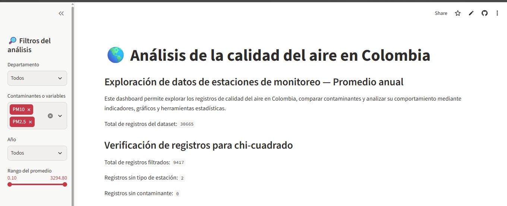

# Análisis de la calidad del aire en Colombia

## Descripción del proyecto

Este proyecto presenta un dashboard interactivo desarrollado con Streamlit para explorar el conjunto de datos **Calidad del Aire en Colombia (Promedio Anual)**. La aplicación permite consultar los registros por departamento, variable ambiental y rango del promedio, además de observar métricas descriptivas y gráficos que facilitan la comprensión de los datos.

El dataset contiene información de estaciones de monitoreo, variables ambientales, años de medición, promedios y ubicación geográfica. Se seleccionó porque permite comparar registros entre departamentos y observar cómo se distribuyen las mediciones ambientales en el país.

## Contenido del repositorio

- `app.py`: código principal de la aplicación Streamlit.
- `dataset.csv`: conjunto de datos utilizado.
- `requirements.txt`: librerías necesarias para ejecutar la aplicación.
- `README.md`: documentación del proyecto.
- `capturas/`: carpeta para guardar la captura del dashboard funcionando.

## Hallazgos principales

- El archivo contiene registros de diferentes variables ambientales y estaciones de monitoreo de Colombia.
- La aplicación permite comparar los promedios registrados por departamento y año.
- Los registros incluyen estaciones clasificadas como fijas e indicativas.
- La prueba Chi-cuadrado de independencia entre `Variable` y `Tipo de Estación` arroja un estadístico de 1281.6951 y un valor p aproximado de 2.95 × 10⁻²⁶⁰.
- El resultado de la prueba indica evidencia de asociación entre las dos variables categóricas; no demuestra causalidad.

## Instalación y ejecución local

1. Instalar Python (versión 3.9 o superior recomendada).
2. Descargar o clonar este repositorio.
3. Abrir una terminal en la carpeta del proyecto.
4. (Opcional, recomendado) Crear un entorno virtual:

   ```bash
   python -m venv venv
   ```

5. Activar el entorno virtual en Windows:

   ```bash
   venv\Scripts\activate
   ```

6. Instalar las dependencias:

   ```bash
   pip install -r requirements.txt
   ```

7. Ejecutar la aplicación:

   ```bash
   streamlit run app.py
   ```

8. Abrir en el navegador la dirección que muestra Streamlit, normalmente `http://localhost:8501`.

## Publicación en Streamlit Community Cloud

1. Subir `app.py`, `dataset.csv`, `requirements.txt` y `README.md` a un repositorio público de GitHub.
2. Ingresar a https://share.streamlit.io/ e iniciar sesión con GitHub.
3. Seleccionar **New app** y elegir el repositorio.
4. Seleccionar la rama y el archivo principal `app.py`.
5. Presionar **Deploy**.
6. Cuando termine la publicación, copiar la URL pública de la aplicación y pegarla aquí:

**Dashboard publicado:** [Agregar aquí la URL de Streamlit]

## Evidencia

Guardar al menos una captura de pantalla del dashboard funcionando en la carpeta `capturas/` y agregarla al repositorio. Después, insertar aquí la imagen, por ejemplo:

```markdown

```

## Información académica

- **Estudiante:** [Escribir nombre del estudiante]
- **Curso:** [Escribir nombre del curso]
- **Universidad:** Universidad Nacional Abierta y a Distancia (UNAD)
- **Fecha:** [Escribir fecha de entrega]

## Fuente de datos

Calidad del Aire en Colombia (Promedio Anual), archivo suministrado para el desarrollo de la actividad académica.
